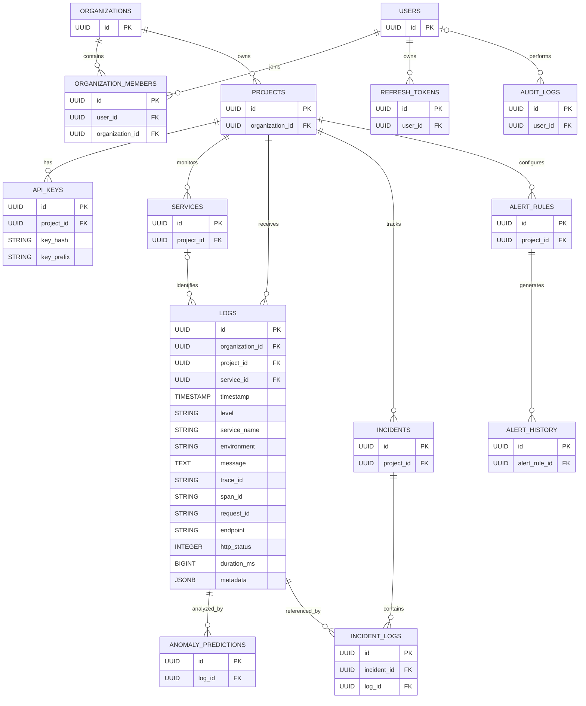

# LogSage AI — Database Entity Relationship Diagram

## 1. Overview

This diagram represents the planned PostgreSQL database structure for LogSage AI.

It covers user management, multi-tenant organization isolation, projects, log ingestion, anomaly detection, incident management, alert evaluation, and security auditing.

**Status:** Planned database design. Final foreign keys, constraints, and cardinalities will be verified during Flyway migration implementation.

## 2. Entity Relationship Diagram



## 3. Entity Groups

### A. Identity and Multi-Tenancy

- USERS
- ORGANIZATIONS
- ORGANIZATION_MEMBERS
- PROJECTS

These entities establish user identity, organization ownership, membership, and project-level isolation.

### B. Ingestion and Observability

- API_KEYS
- SERVICES
- LOGS

These entities support secure application log ingestion and service monitoring.

### C. Machine Learning and Incident Management

- ANOMALY_PREDICTIONS
- INCIDENTS
- INCIDENT_LOGS

These entities connect anomaly analysis with incident investigation and supporting log evidence.

### D. Alerting and Security

- ALERT_RULES
- ALERT_HISTORY
- AUDIT_LOGS
- REFRESH_TOKENS

These entities support alert evaluation, notification history, auditing, and session management.

## 4. Important Relationships

| Relationship | Cardinality |
|---|---|
| Users → Organization Members | One-to-Many |
| Organizations → Organization Members | One-to-Many |
| Organizations → Projects | One-to-Many |
| Projects → API Keys | One-to-Many |
| Projects → Services | One-to-Many |
| Projects → Logs | One-to-Many |
| Logs → Anomaly Predictions | One-to-Many |
| Incidents → Incident Logs | One-to-Many |
| Logs → Incident Logs | One-to-Many |
| Projects → Incidents | One-to-Many |
| Projects → Alert Rules | One-to-Many |
| Alert Rules → Alert History | One-to-Many |
| Users → Refresh Tokens | One-to-Many |

## 5. Database Design Principles

- PostgreSQL is the source of truth.
- UUID identifiers are used for major entities.
- JSONB supports flexible structured log metadata.
- Foreign keys enforce relational integrity.
- Indexes support project-scoped log searches.
- Organization isolation is enforced by backend authorization.
- Flyway manages version-controlled schema migrations.
- Raw ingestion API keys are never stored in plaintext.

## 6. Implementation Notes

The diagram is a planned logical model, not a verified physical database schema.

The following details require finalization during implementation:

1. Exact columns and constraints for entities whose complete schemas are not yet documented.
2. Whether anomaly predictions reference individual logs, time windows, or both.
3. Incident assignment and lifecycle history relationships.
4. Audit log organization and actor relationships.
5. Exact foreign keys and delete/update policies.
6. Unique constraints and index definitions.

All relationships must be verified against the actual Flyway migrations and JPA mappings before the database design is considered complete.
```

## Step 2: Save and verify

Press `Ctrl + S`, then run:

```powershell
(Get-Content docs/diagrams/database-er-diagram.md).Count
git status --short
```

<text color="success" weight="medium" size="sm">Expected</text>

A new file should appear:

```text
?? docs/diagrams/database-er-diagram.md
```

Send me the output. We'll validate the diagram and commit it separately.

**After this:** We'll review the two diagrams together and check whether the ERD matches the database design before marking this documentation milestone complete.