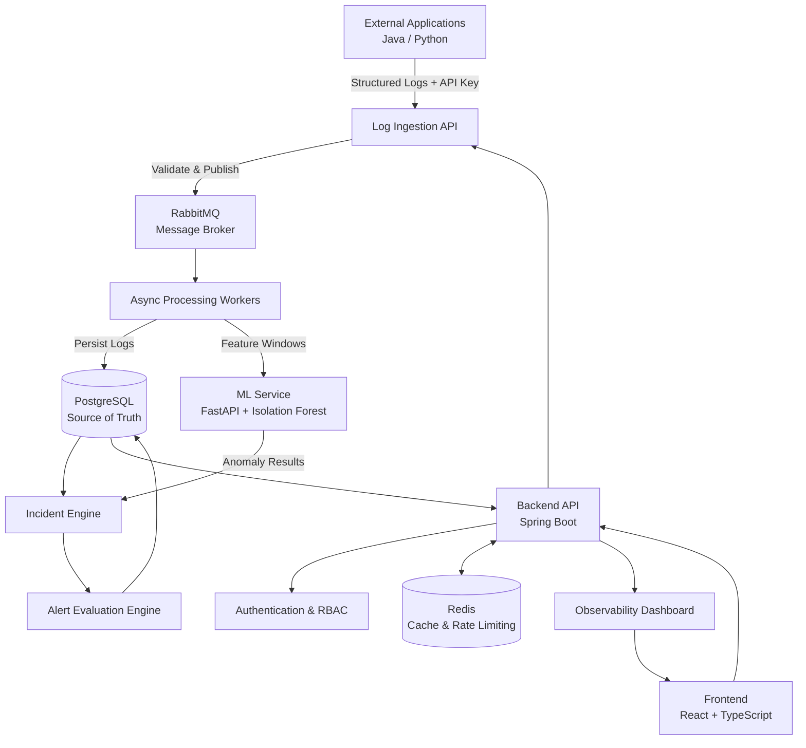
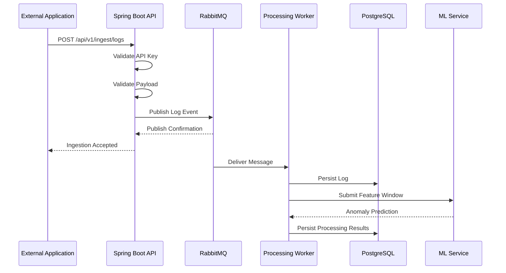

# LogSage AI — System Architecture

## 1. High-Level Architecture



## 2. Log Ingestion Workflow



## 3. Core Architecture Principles

- Spring Boot backend follows a modular monolith architecture.
- PostgreSQL is the persistent source of truth.
- RabbitMQ handles asynchronous event processing.
- Redis is used for caching and rate limiting.
- Python ML service operates independently from the main backend.
- Log ingestion must not depend on successful ML inference.
- Frontend displays data retrieved from backend APIs.
- Organization and project isolation must be enforced by the backend.
```
